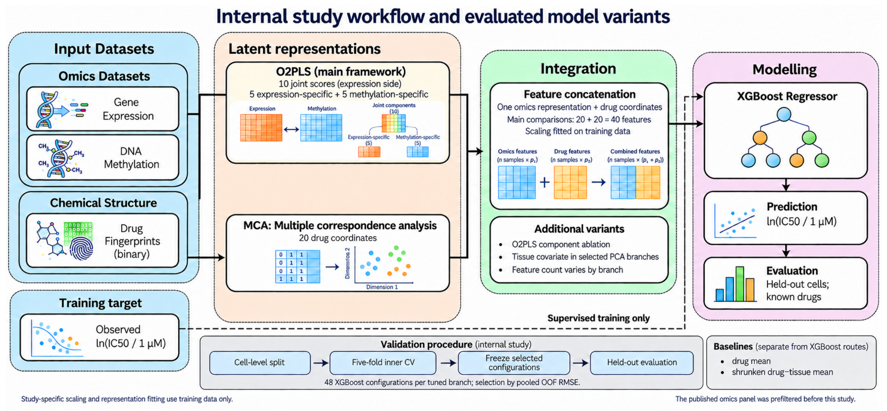

# O2MCA: joint and modality-specific omics representations for drug response prediction

Code and data for the manuscript

> Alsubaie SMK, Zhang W, Moscato P. *Evaluating joint and modality-specific omics representations for cancer drug response prediction: an internal benchmark and exploratory cross-study evaluation.*

The study asks whether separating shared (joint) and modality-specific variation between gene expression and DNA methylation with O2PLS improves prediction of drug response (ln IC50) for unseen cancer cell lines. All representations are compared under the same XGBoost learner, the same development folds and the same tuning grid.



## Quick start

1. Download or clone this repository.
2. Open `O2MCA.Rproj` in RStudio.
3. Run the nine scripts in order with **Source**, waiting for each to finish. Each script is self-contained. On first run, the input files are restored automatically from `data/`.

| Script | What it does | Output in `results/` |
|---|---|---|
| `01_read_and_align_data.R` | Reads the original expression and methylation files, restores verified feature names and checks them | `01_data` |
| `02_build_cohort_and_folds.R` | Builds the cell–drug pairs, the 587/147 cell split and the inner folds; checks all prepared inputs | `01_data`, `input_check`, `external_check` |
| `03_train_and_tune_models.R` | Inner cross-validation of the five primary representations | `02_cv` |
| `04_ablation_and_modality_comparisons.R` | O2PLS ablations, single-modality and tissue-augmented routes | `02_cv` |
| `05_sensitivities_and_internal_test.R` | Rank and source sensitivity, final held-out evaluation, permutation and registry sensitivity | `05_*`, `06_internal`, `13_registry`, `14_permutation` |
| `06_external_validation.R` | CCLE expression-only and reduced-panel experiments | `12_external_cv`, `07_external`, `13_external_inference` |
| `07_feature_stability_and_biology.R` | Stable O2PLS features, CpG–expression and case-study associations, GO enrichment | `08_features`, `09_biology`, `09_expression_GO` |
| `08_manuscript_tables_and_figures.R` | All manuscript tables and figures, and a check of 113 published values | `10_report` |
| `09_linear_baselines.R` | Post hoc comparison of ordinary least squares, ridge and elastic net on the same O2PLS–MCA features (run after steps 03 and 05) | `15_linear_baselines_*` |

Step 02 must print five `TRUE` checks before you continue. Steps 03–05 fit several thousand XGBoost models and are slow; cross-validation results are cached and resume after an interruption. Final fits refuse to overwrite an existing output folder.

## Where each manuscript result comes from

| Manuscript item | Script | File in `results/10_report/` |
|---|---|---|
| Table 1, cohorts | 08 | `Table1_cohorts.csv` |
| Table 2, internal held-out metrics (15 paths) | 05 → 08 | `Table2_internal_metrics.csv` |
| Table 3 and Figure 3, six adjusted contrasts | 05 → 08 | `Table3_internal_contrasts.csv`, `Figure3_internal_contrasts.pdf` |
| Figure 2, Tables S6–S7, within-drug analysis | 05 → 08 | `Figure2_within_drug.pdf`, `TableS6_within_drug_detail.csv`, `TableS7_within_drug_summary.csv` |
| Table 4 and Figure 4, MGMT and SLFN11 | 07 → 08 | `Table4_case_studies.csv`, `Figure4_biology.pdf` |
| Tables 5–6 and Figures 5–6, external experiments | 06 → 08 | `Table5_external_expression.csv`, `Table6_external_reduced.csv`, `Figure5_*.pdf`, `Figure6_*.pdf` |
| Table 7, per-drug external RMSE | 06 → 08 | `Table7_external_per_drug.csv` |
| Table S5, stable features | 07 → 08 | `TableS5_stable_features.csv` |

| Manuscript item | Script | File in `results/15_linear_baselines_*/` |
|---|---|---|
| Table 8, linear learner comparison | 09 | `test_metrics.csv`, `selected_on_development.csv`, `development_grid.csv` |

| Manuscript item | Script | Output |
|---|---|---|
| Development out-of-fold RMSE and selected configurations (Table S1) | 03, 04 | `02_cv/selected_configurations.csv` |
| Rank 12/28 and single-reference sensitivity (Table S2) | 05 | `05_rank12/`, `05_rank28/`, `05_source/` |
| Calibration, per-drug and per-tissue metrics | 05 | `06_internal/` |
| WIL2-NS registry sensitivity | 05 | `13_registry/` |
| Below-maximum-dose sensitivity | 06 | `13_external_inference/` |
| CpG–expression associations (3,167 tests) | 07 | `09_biology/cis_associations_all.csv` |
| Methylation GO enrichment (Table S3) | 07 | `09_biology/methylation_GO_BP_all.csv` |
| Expression GO enrichment (Table S8) | 07 | `09_expression_GO/` |
| Figure 1 | — | drawn by the authors: `docs/framework.pdf` |

## Data

| File | Content |
|---|---|
| `data/data.rds` | Reference results and annotation tables, restored into `data/` |
| `data/inputs.rds.part00`–`part06` | The four original CSV files (restored into `raw_data/`) and the two external fitting inputs (restored into `prepared_inputs/`) |
| `prepared_inputs/development_cell_metadata.csv` | Development cell tissue labels |
| `config/` | Recorded model choices, input checksums and the published values checked by step 08 |

The four CSV files are the processed GDSC tables released by Chen and Zhang (Brief Bioinform 2021; https://github.com/Jinyu2019/Suppl-data-BBpaper). The response is already ln(IC50/1 µM); do not transform it again. The external inputs are prepared from CCLE (Broad Institute) and PHEB (Ohnmacht et al., Commun Biol 2023). The large inputs are split into parts below 25 MB for GitHub. Every restored file is checked against the SHA-256 values in `config/` before use.

## Requirements

R 4.5.1. The scripts stop if a model package version differs from the one used in the study:

```r
install.packages("remotes")
remotes::install_version("OmicsPLS",   "2.1.0")
remotes::install_version("FactoMineR", "2.14")
remotes::install_version("xgboost",    "3.2.1.1")
remotes::install_version("r.jive",     "2.4")
remotes::install_version("digest",     "0.6.39")
remotes::install_version("jsonlite",   "2.0.0")

install.packages("BiocManager")
BiocManager::install(c("AnnotationDbi", "org.Hs.eg.db", "GO.db",
                       "IlluminaHumanMethylation450kanno.ilmn12.hg19"))

install.packages("glmnet")
```

Step 09 also needs `glmnet`. The study used `org.Hs.eg.db` and `GO.db` 3.22.0 and `IlluminaHumanMethylation450kanno.ilmn12.hg19` 0.6.1.

## Notes

- The held-out test cells are used only after configurations were selected on development cells. Final fits use the recorded configurations in `config/final_internal_choices.json`.
- The biological analyses were specified after the predictive evaluation and are exploratory.
- A rerun of the final internal and external models reproduced the archived predictions exactly, and 113 numeric values in Tables 2, 3, 5, 6 and 7 matched the manuscript (see `validation/`).

## Citation

Please cite the manuscript above if you use this code.

## License

See `LICENSING.md`.
